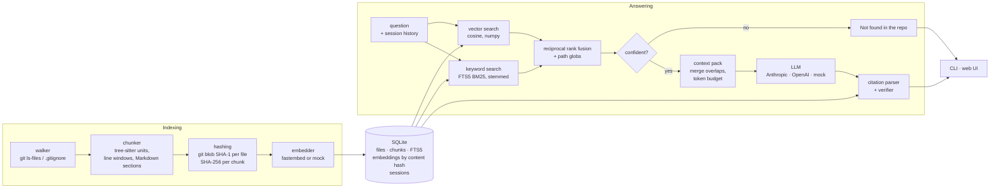

# repo-qa

Ask natural-language questions about a local git repository and get answers that are
**grounded in the code and cite it** — every `path:start-end` reference is checked against
the index before you see it. Works from a CLI or a small web UI, runs fully offline with
the built-in mock providers, and uses Claude or OpenAI when you configure a key.

Illustrative session with a real LLM provider configured:

```text
$ repo-qa ask "How are citations verified?"
Citations are parsed from the model's answer and each one is checked against the stored
file and line count, then against the context the model was shown
(src/repo_qa/answering/citations.py:72-113).

✓ src/repo_qa/answering/citations.py:72-113
```

## Quickstart

Requires Python 3.12.

```bash
python -m venv .venv
source .venv/bin/activate            # Windows: .venv\Scripts\activate
pip install -e ".[anthropic]"        # or ".[openai]", or no extra for offline use

repo-qa index /path/to/your/repo     # first run downloads a small local ONNX embedding model
repo-qa search "where is the retry logic"
repo-qa ask "How does authentication work?"
repo-qa status
repo-qa serve                        # http://127.0.0.1:8000
```

Answers come from the offline mock provider until you pick a real one:

```bash
export ANTHROPIC_API_KEY=...         # or OPENAI_API_KEY
export REPO_QA_LLM=anthropic         # or openai
```

Re-running `repo-qa index` is incremental: unchanged files are skipped and only new chunk
contents are embedded.

### Configuration

All settings are environment variables (see [`.env.example`](.env.example)); most have a
matching CLI flag.

| Variable | Default | Meaning |
|---|---|---|
| `REPO_QA_DB` | `~/.repo-qa/index.db` | Central index holding every indexed repo |
| `REPO_QA_EMBEDDER` | `fastembed` | `fastembed` (local ONNX) or `mock` (deterministic) |
| `REPO_QA_EMBED_MODEL` | `BAAI/bge-small-en-v1.5` | Any fastembed text model |
| `REPO_QA_LLM` | `mock` | `mock`, `anthropic` or `openai` |
| `REPO_QA_LLM_MODEL` | provider default | Claude: `claude-opus-5-5` |
| `REPO_QA_TOP_K` | `8` | Chunks retrieved per question |
| `REPO_QA_TOKEN_BUDGET` | `6000` | Context tokens sent to the model |
| `REPO_QA_MIN_VECTOR_SCORE` | per embedder | Cosine needed to trust a vector-only match |
| `REPO_QA_MAX_FILE_BYTES` | `1000000` | Larger files are not indexed |

### Commands

| Command | What it does |
|---|---|
| `repo-qa index [PATH] [--force]` | Index or incrementally re-index a repo |
| `repo-qa search QUERY [-k N] [-i GLOB] [-x GLOB] [--json]` | Hybrid search with per-retriever scores |
| `repo-qa ask QUESTION [--show-context] [--json]` | Grounded answer with verified citations (exit 2 = not found) |
| `repo-qa eval FILE [-k N] [--answers] [--min-hit-rate X]` | Hit-rate@k, MRR and citation precision |
| `repo-qa serve [--host] [--port]` | Web UI |
| `repo-qa status [--json]` | Indexed repos, file/chunk counts, model, HEAD |

`--repo` selects a repo by id, name or path; by default it is the indexed repo containing
the current directory, or the only one.

## Architecture



| Package | Responsibility |
|---|---|
| `indexing/` | Walk the repo, hash files, orchestrate incremental indexing |
| `chunking/` | Language detection, tree-sitter chunking, line-window and Markdown fallback |
| `embeddings/` | `EmbeddingProvider` protocol, fastembed and mock implementations |
| `store/` | SQLite schema, migrations, FTS5 triggers, typed `Store` |
| `retrieval/` | Vector search, keyword search, RRF fusion, context pack |
| `answering/` | Prompts, LLM providers, citation verification, QA engine, session memory |
| `evaluation/` | Metrics and the JSONL eval runner |
| `cli.py`, `web/` | Typer CLI; FastAPI + Jinja2 + htmx UI |

### Data model

| Table | Key columns |
|---|---|
| `repos` | `root_path` (unique), `head_commit`, `embed_model`, `embed_dim`, `indexed_at` |
| `files` | `(repo_id, path)`, `language`, `size`, `line_count`, `blob_hash` |
| `chunks` | `path`, `language`, `kind`, `symbol`, `start_line`, `end_line` (1-based, inclusive), `text`, `terms`, `content_hash`, `blob_hash` |
| `embeddings` | `(content_hash, model)` → float32 `vector` blob |
| `chunks_fts` | FTS5 over `text`, `symbol`, `path`, `terms`, synced by triggers |
| `sessions`, `messages` | conversation memory per repo |

## Design decisions

### Why syntactic chunking

Fixed-size windows cut functions in half, so the top hit often holds the end of one function
and the start of the next. repo-qa uses tree-sitter (Python, JavaScript, TypeScript/TSX, C#,
Java, Go, Rust) so that:

- **Every function and method is one chunk**, with its leading doc comments, decorators and
  attributes, and a qualified symbol such as `Cart.total_price`, `Item.Describe` (Go
  receiver) or `Point.norm` (Rust `impl`). A retrieved chunk is a complete unit the model
  can read, and citations line up with real boundaries.
- **Nothing is lost between functions.** Lines outside any function, such as imports,
  constants, class headers and fields, become gap chunks tagged with the enclosing type, so
  every meaningful line is indexed exactly once (tested per language).
- **Oversized units are windowed but keep their symbol**, and parsing never blocks
  indexing: syntax errors still produce chunks, and any failure falls back to 60-line
  windows. Markdown is split by heading, with the heading path as its symbol.

### Why hybrid retrieval

Code questions mix two kinds of signal. Some name things exactly (`parseRoute`, an error
string, a config key), which keyword search finds and embeddings blur. Others describe
behaviour ("where do we retry failed payments?"), which embeddings handle and keywords miss.
repo-qa runs both and fuses them with **reciprocal rank fusion**
(`score = Σ 1/(60 + rank)`):

- RRF uses ranks, not scores, so cosine similarity and BM25 never need calibrating against
  each other.
- A chunk ranked well by both retrievers beats one ranked first by only one.
- Keyword search is code-aware. Identifiers are split (`parseHttpRequest` → `parse http
  request`) into an extra FTS column, words are Porter-stemmed (`refunds` finds
  `refund_payment`), and user text is fully quoted, so it can never form an invalid
  `MATCH` expression.
- Vector search is brute-force cosine over an in-memory matrix, cached per index version.
  That is exact and fast enough for repositories up to roughly 100k chunks.

### How citations are verified

The model is told to answer only from the numbered excerpts it is given, to cite them as
`path:start-end`, and to reply `NOT_FOUND` if they don't contain the answer. After it
answers:

1. **Parse.** A regex finds `path:12-40`, `path:12`, `L12-L40`, `#L12-L40` and en dashes.
   Tokens that aren't paths (`localhost:8080`, `10:30`) are ignored. A bare filename
   resolves to a full path only when the match is unique.
2. **Verify against the index.** The path must be an indexed file and the range must lie
   within its stored line count.
3. **Check grounding.** The range must overlap the context the model was actually shown.

Each citation ends up in one of three states:

| Status | Meaning | Shown as |
|---|---|---|
| `verified` | Exists and overlaps the provided context | green link to the cited lines |
| `ungrounded` | Exists but was not in the context | amber link, flagged |
| `invalid` | Unknown path or impossible range | removed from the list, marked `[⚠ invalid citation]` inline |

**Not found instead of guessing.** Before calling the model, a confidence gate requires
either a keyword match on the top hit or a cosine score above a per-embedder threshold.
Otherwise repo-qa answers "Not found in the repo" without spending tokens. If the model
replies `NOT_FOUND`, the result is the same.

### Other choices

- **Incremental by content hash.** Files are skipped when their git blob hash is unchanged.
  Embeddings are keyed by the SHA-256 of the embedded text, so editing one function
  re-embeds one chunk, identical chunks share a vector, and switching models re-embeds
  without re-chunking.
- **One central SQLite file** (WAL, FTS5) holds every repo, which gives the web UI its repo
  picker and needs no server. The schema is versioned and migrated forward.
- **Offline by default.** The mock embedder (feature-hashed tokens) and mock LLM (cites the
  top context regions) are deterministic, so the whole pipeline is tested in CI with no
  network or keys.
- **Claude provider.** It defaults to `claude-opus-5-5` at medium effort, with server-side
  refusal fallbacks turned on. A refusal surfaces as an error rather than an empty answer.

## Evaluation

```bash
repo-qa eval evals/repo_qa_self.jsonl -x "evals/*"            # retrieval only
repo-qa eval evals/repo_qa_self.jsonl --answers                # + citation precision
```

An eval set is JSONL with one case per line:

```json
{"question": "Where is the git blob hash computed?", "expected_paths": ["src/repo_qa/indexing/hashing.py"], "expected_substrings": ["git_blob_hash"]}
```

| Metric | Definition |
|---|---|
| hit-rate@k | Share of questions with an expected path in the top k chunks |
| MRR@k | Mean of 1/rank of the first expected path (0 if none in top k) |
| substring hit-rate | Share of questions whose top-k text contains every expected substring |
| citation precision | Share of kept citations that are verified and point at an expected file. Computed with `--answers`, by default only with a real LLM provider |

`evals/repo_qa_self.jsonl` has 22 questions about this codebase, and the test suite runs
it offline against repo-qa itself with the mock embedder:

| Scope | hit-rate@5 | MRR@5 | Floor enforced |
|---|---|---|---|
| Source only (`-x "evals/*" -x "tests/*"`) | 0.955 | 0.667 | 0.90 / 0.60 |
| Everything (`-x "evals/*"`) | 0.773 | 0.538 | 0.70 / 0.45 |

Test files restate the identifiers of the code they test, so with a purely lexical embedder
they are the main competitors for source chunks. Use `--exclude` to scope questions away from
them. These are mock-embedder numbers; run the same command with `fastembed` to measure
the real model.

## Development

```bash
pip install -e ".[dev,anthropic,openai]"
ruff check . && ruff format --check .
pytest                                   # fully offline
REPO_QA_TEST_FASTEMBED=1 pytest -k fastembed   # optional: real embedding model
```

CI runs ruff and pytest on Ubuntu and Windows. Dependencies are pinned exactly in
`pyproject.toml`. `tree-sitter` is held at 0.25.2 because 0.26.0 corrupts the heap on
Windows.

## Roadmap

- **Multi-repo questions:** search across several indexed repos at once, with
  repo-qualified citations.
- **Watch mode:** `repo-qa watch` re-indexes changed files on save, using filesystem events
  and the existing incremental path.
- **VS Code extension:** ask from the editor, with citations that open the exact lines.
- **Reranker:** an optional cross-encoder pass over the fused top-N before packing the
  context.
- **Richer eval:** answer-quality grading, per-language breakdowns, regression reports
  between runs, and larger third-party eval sets.
- **Scale:** sqlite-vec or an ANN index for very large repositories, and streaming answers
  in the web UI.

## License

[MIT](LICENSE) © 2026 Shahid Ul Islam
